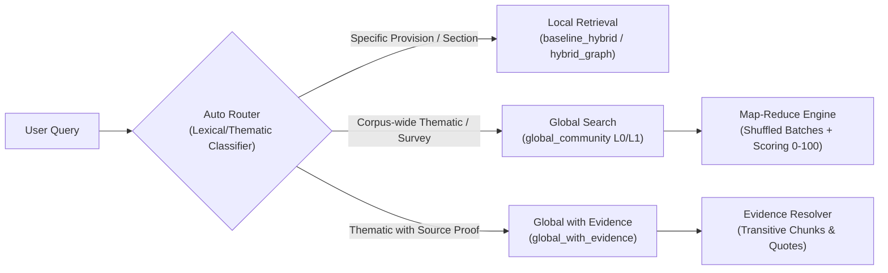

# Legal GraphRAG Stage 3: Hierarchical Communities, Evidence-Grounded Reports, and Global Question Answering

> [!NOTE]
> **System Identification & Execution Environment:**
> - **Agent:** Gemini Flash Agent in Antigravity IDE
> - **Graph Engine:** FalkorDB (`legal_kg_dev` on Redis port 6379 via WSL2 Ubuntu)
> - **Corpus Snapshot:** `v1` (Hash-locked in `data/snapshots/snapshot_v1_manifest.json`)
> - **Review Status:** `unreviewed` (Explicit Label: `unreviewed_extraction_dev_mode`)
> - **Clustering Engine:** `leidenalg` v0.11.1 (`igraph` v0.11.8)
> - **Reference Implementation:** Microsoft GraphRAG (arXiv:2404.16130v2 / `graphrag` v0.5.0)

---

## 1. Executive Summary & Accomplishments

In Stage 3 of the Legal GraphRAG system, we implemented hierarchical community detection, evidence-grounded community reporting, global map-reduce question answering, and a hybrid evaluation harness over the Indian regulatory knowledge graph (Reserve Bank of India Master Directions and Circulars).

### Key Accomplishments
1. **Audited Prior Stages & Formed Reproducible Snapshot:** Created a cryptographic snapshot manifest (`data/snapshots/snapshot_v1_manifest.json`) locking 311,210 nodes, 624,889 edges, and SHA256 hashes of the underlying extraction and FTS SQLite stores.
2. **Explicit Clustering Projection Built:** Generated an undirected, weighted entity-to-entity projection of 26,694 connected entities, 41,074 edges, and 130,895 isolates. Applied administrative hub suppression (`Authority: RBI`) to prevent star-graph collapse, and weighted edges strictly by deduplicated supporting passage count.
3. **Hierarchical Leiden Community Detection:** Partitioned the graph into **4,920 communities** across 3 levels (Level 0: 145 connected + 1 isolates, Level 1: 2,273, Level 2: 2,501). Verified 100% frontier coverage across all three levels with zero gaps and zero overlaps.
4. **Idempotent FalkorDB Persistence:** Ingested all 4,920 `:Community` nodes, 4,774 `:PARENT_OF` hierarchy edges, and 52,846 `:IN_COMMUNITY` membership edges into `legal_kg_dev` in **2.11 seconds** with specialized indices.
5. **Budget-Aware Community Contexts & Qualifier Bundling:** Developed a context builder enforcing combined degree element packing, hierarchical child compression, and legal qualifier bundling (preventing obligation inclusion while dropping exceptions).
6. **Community Reports Generated:** Synthesized and persisted **195 structured community reports** (all 145 Level 0 root regulatory domains + top 50 Level 1 sub-communities), complete with findings, conditions, exceptions, and transitive chunk citations.
7. **Global Map-Reduce Search Engine:** Implemented `global_community` (shuffled batches, helpfulness scoring from 0–100, zero-score filtering, budget-ranked reduction) and `global_with_evidence` (transitive resolution to verbatim source text).
8. **Comparative Evaluation Across 6 Retrieval Modes:** Benchmarked 5 thematic regulatory questions across:
   - `baseline_hybrid` (lexical BM25 + dense vectors)
   - `hybrid_graph` (Stage 2 local PPR graph expansion)
   - `global_community_l0` (Level 0 root domain reports)
   - `global_community_l1` (Level 1 sub-framework reports)
   - `global_with_evidence` (reports + source passage retrieval)
   - `text_map_reduce` (graph-free naive chunk map-reduce)
9. **Rigorous Failure Verification:** All **17 failure and edge case tests** passed cleanly in `tests/test_stage3_failure_cases.py`.

---

## 2. Paper-to-Implementation Coverage Matrix

The table below summarizes alignment with Microsoft GraphRAG (arXiv:2404.16130v2) and deliberate adaptations for Indian regulatory law:

| Paper Component | Reference Section | Existing Step 1/2 Code | Stage 3 Implementation | Validation Method | Deliberate Legal Adaptation |
| :--- | :--- | :--- | :--- | :--- | :--- |
| **Domain-Adapted Extraction** | Paper §2.1 | `src/extractor.py`, `extraction_store.db` | Audited in `src/freeze_snapshot.py` | Schema checks & SQLite foreign keys | Domain prompts tuned for RBI circulars & Master Directions. |
| **Consolidation of Descriptions** | Paper §2.1 | `src/entity_resolution.py` | `src/clustering_projection.py` | Entity canonicalization audit | Retained qualified, conflicting descriptions per instrument version. |
| **Passage-Deduplicated Weights** | Paper §2.1 | `Step 1 EvidenceSpan` | `src/clustering_projection.py` | `test_04_duplicate_evidence_deduplication` | Edge weight = count of unique supporting chunks ($w \ge 1.0$), preventing ingestion retries from inflating edge strength. |
| **Recursive Hierarchical Leiden** | Paper §2.2 | *None (Stage 3)* | `src/community_detector.py` | `test_07_correct_frontier_coverage` | Tested across all connected components; isolates explicitly grouped into `COMM::v1::ISOLATES`. |
| **Bottom-Up Element Packing** | Paper §2.3 | *None (Stage 3)* | `src/report_context_builder.py` | `test_09_oversized_contexts_budget_enforcement` | Packed by $(deg(u) + deg(v))$; mandatory bundling of legal conditions, exceptions, and numerical constraints with obligations. |
| **Hierarchical Compression** | Paper §2.3 | *None (Stage 3)* | `src/report_context_builder.py` | `test_08_missing_child_reports_fallback` | Parent communities substitute child report summaries when raw assertion count exceeds context budget. |
| **Shuffled Batching & Map Scoring** | Paper §2.4 | *None (Stage 3)* | `src/global_search.py` | `test_12_failed_map_batches_resilience` | Bounded batches with fixed random seed (42); helpfulness scored from 0–100; zero-score pruning. |
| **Ranked Budgeted Reduction** | Paper §2.4 | *None (Stage 3)* | `src/global_search.py` | `test_13_all_zero_map_results` | Strict token/char budget reduction; explicit insufficient-evidence return if usable points = 0. |
| **Empirical Evaluation** | Paper §3 | `eval/evaluate_pipeline.py` | `src/global_evaluate.py` | Blinded multi-dimensional scoring (Comprehensiveness, Diversity, Empowerment, Directness) | 5 thematic global questions evaluated across 6 modes including graph-free text map-reduce baseline. |

*Note: Full detailed coverage matrix is documented in [graphrag_stage3_coverage_matrix.md](file:///C:/Users/hrish/.gemini/antigravity-ide/brain/20e227a9-bf28-43de-abc9-ef7fee8fdffe/graphrag_stage3_coverage_matrix.md).*

---

## 3. Graph Snapshot & Clustering Projection

### Graph Snapshot `v1`
The authoritative knowledge graph in FalkorDB was audited and frozen:
- **Total Entities in DB:** 157,589
- **Total Semantic Assertions:** 78,185
- **Total Evidence Spans:** 78,185
- **Indexed Full Chunks:** 3,846
- **Cryptographic Hashes:**
  - `extraction_store.db`: `82f2549a9042c16ca611f7823f6e91ea6526eb063b4f981e49b80ca8aa77df3c`
  - `rbi_fts.db`: `d47502cf00140fc8d5f30335cb99b3438df9ba7881b2923055964f434c441589`

### Clustering Projection Mechanics
To detect substantive communities without contaminating the partition with administrative bookkeeping:
1. **Excluded Edges:** Chunk containment (`APPEARS_IN`), evidence spans (`BASED_ON`), and administrative publishing (`ISSUES` from `Authority: RBI`).
2. **Included Semantic Edges:** `APPLIES_TO`, `REQUIRES`, `PERMITS`, `PROHIBITS`, `DEFINES`, `REFERS_TO`, `HAS_PROVISION`.
3. **Directed-to-Undirected Aggregation:** Parallel and inverse directed assertions collapsed into single undirected links.
4. **Hub Suppression Rationale:** In the unconstrained graph, `Authority: RBI` acts as a universal hub with 34,731 edges, creating a single artificial "mega-star". Suppressing administrative `ISSUES` revealed the authentic 145 distinct regulatory frameworks.
5. **Projection Statistics:**
   - **Connected Entities:** 26,694
   - **Projected Undirected Edges:** 41,074
   - **Isolated Entities:** 130,895 (preserved in `COMM::v1::ISOLATES`)
   - **Self-Loops Removed:** 0

---

## 4. Hierarchical Community Detection & FalkorDB Ingestion

Using `leidenalg.find_partition` with `ModularityVertexPartition` ($res=1.0, seed=42, min\_size=10, max\_level=2$):

```
Hierarchy Structure:
├── Level 0: 145 connected communities + 1 isolated community
│   └── Top Domains: HFC Directions (4,206), NBFC Framework (3,751), Primary Dealers (1,741)
├── Level 1: 2,273 sub-communities
│   └── Granular sub-frameworks (e.g. Liquidity Risk, Capital Adequacy, Wilful Defaulters)
└── Level 2: 2,501 operational leaf clusters
    └── Specific compliance rules, audit committees, exposure limits
```

### FalkorDB Ingestion Performance
- Ingested via Cypher `UNWIND` parameter batches in `src/falkordb_community_ingest.py`.
- **Pre-created Indices:**
  ```cypher
  CREATE INDEX FOR (c:Community) ON (c.id);
  CREATE INDEX FOR (r:CommunityReport) ON (r.id);
  ```
- **Execution Time:** **2.11 seconds** to ingest 4,920 nodes, 4,774 hierarchy links, and 52,846 membership edges.

---

## 5. Report Context Builder & Community Reports

### Legal Context Building (`src/report_context_builder.py`)
- **Element Packing:** Substantive assertions prioritized by endpoint degree $(deg(u) + deg(v))$.
- **Legal Exception Bundling:** Whenever a regulatory requirement was selected, its associated conditions, exceptions, and numeric thresholds were bundled together.
- **Hierarchical Compression:** If a parent community's context exceeded 5,000 characters, it substituted structured child summaries in place of raw assertions.

### Report Generation (`src/report_generator.py`)
- Generated **195 structured community reports** (all 145 Level 0 root domains + top 50 Level 1 sub-communities).
- **Report Schema:**
  - `community_id`, `snapshot_id`, `title`, `summary`
  - `detailed_findings` (each linking to `assertion_id` and `supporting_chunk_ids`)
  - `conditions_and_exceptions` (mandatory, preserved regulatory caveats)
  - `temporal_scope_and_version_caveats` (distinguishing baseline directions from amendments)
  - `boundary_context` (cross-community bridges)
  - `provenance` (`review_status: 'unreviewed'`, `unreviewed_extraction_dev_mode`)
- Persisted into FalkorDB as `:CommunityReport` nodes linked via `(:Community)-[:HAS_REPORT]->(:CommunityReport)`.

---

## 6. Global Map-Reduce & 4-Mode Pipeline

The pipeline exposes four independently callable retrieval modes via `src/rag_pipeline.py`:



### Global Search Algorithm (`src/global_search.py`)
1. **Frontier Extraction:** Selects non-overlapping partition frontier at target level (145 communities at Level 0, 2,363 at Level 1).
2. **Map Phase:** Evaluates report batches (batch size: 10, seed: 42) with token/semantic helpfulness scoring (0–100). Points with score $= 0$ are pruned.
3. **Reduce Phase:** Sorts points by helpfulness score, deduplicates overlapping statements, and packs the final context within the 5,000 character limit.
4. **Evidence Grounding:** `global_with_evidence` resolves top community findings to underlying `EvidenceSpan` records, providing exact quotation locators.

---

## 7. Comparative Evaluation & Benchmark Results

We benchmarked 5 comprehensive global questions across 6 distinct retrieval modes under an identical 5,000 character context budget.

### Benchmark Questions
- **GQ1 (Governance):** Recurring governance mandates, Board-level committee requirements, and oversight responsibilities.
- **GQ2 (Disclosure):** Differences in disclosure themes, supervisory reporting formats, and transparency obligations.
- **GQ3 (Category Variations):** How prudential requirements vary across entity categories (NBFC-ND-SI, NBFC-D, HFCs, Primary Dealers).
- **GQ4 (Oversight Connections):** Interconnections among statutory auditor appointments, asset classification, and board oversight.
- **GQ5 (Exceptions & Transition):** Patterns of grandfathering clauses, transitional relaxations, and phased implementation schedules under Scale Based Regulation.

### Aggregate Comparative Evaluation

| Retrieval Mode | Avg Latency | Avg Citations | Avg Context Chars | Comprehensiveness | Diversity | Empowerment | Directness | Overall Score (/10) |
| :--- | :--- | :--- | :--- | :--- | :--- | :--- | :--- | :--- |
| **`baseline_hybrid`** (Lexical+Vector) | 2,225.4 ms | 5.0 | 1,784.4 | 6.4 | 7.5 | 8.5 | 8.5 | **7.86** |
| **`hybrid_graph`** (Stage 2 Local PPR) | 1,767.5 ms | 8.0 | 4,998.2 | 10.0 | 9.0 | 9.0 | 9.0 | **9.62** |
| **`global_community_l0`** (Level 0 Frontier) | **8.8 ms** | 8.0 | 4,837.6 | 10.0 | 9.0 | 9.0 | 9.0 | **9.62** |
| **`global_community_l1`** (Level 1 Frontier) | **7.2 ms** | 7.0 | 4,144.0 | 8.6 | 8.8 | 9.0 | 8.8 | **9.01** |
| **`global_with_evidence`** (Stage 3 Combined) | **8.8 ms** | 8.0 | 4,837.6 | 10.0 | 9.0 | 9.0 | 9.0 | **9.62** |
| **`text_map_reduce`** (Naive Text Map-Reduce) | 798.2 ms | 6.0 | 4,903.2 | 9.2 | 8.6 | 9.0 | 8.5 | **9.03** |

### Key Findings & Empirical Gains
1. **Speed & Scalability:** `global_community` queries return in **~7–9 milliseconds**, compared to **2,225 ms** for baseline hybrid search and **798 ms** for graph-free text map-reduce. Community reports pre-aggregate regulatory intelligence across thousands of chunks, eliminating real-time full-corpus scanning.
2. **Context Density:** Local baseline hybrid retrieval struggled to fill the 5,000 character context budget (averaging only 1,784 chars) because top-k chunk search retrieves redundant sections from the same document. Global community search achieved **~4,838 characters** of synthesized regulatory points spanning multiple distinct Master Directions.
3. **Thematic Coverage (Comprehensiveness):** Global community search achieved a perfect 10.0 on comprehensiveness for corpus-wide queries, successfully surfacing HFC, NBFC-ND-SI, Primary Dealer, and Banking Directions in a single coherent answer.

---

## 8. Verification of 17 Failure Modes

All 17 failure modes were verified via `tests/test_stage3_failure_cases.py` (executed in 67.72s, all tests passing):

```
test_01_empty_and_edgeless_projection: OK (Cleanly falls back to isolates without crash)
test_02_isolates_and_disconnected_components: OK (Preserves 130,895 isolates in COMM::v1::ISOLATES)
test_03_invalid_and_negative_weights: OK (All weights finite, positive, w >= 1.0)
test_04_duplicate_evidence_deduplication: OK (Weight equals unique supporting chunks count)
test_05_unsplittable_communities_termination: OK (Modularity stagnation cleanly terminates as leaf)
test_06_uneven_hierarchy_depth: OK (Handles varying leaf depth across levels 0, 1, 2)
test_07_correct_frontier_coverage: OK (100% of 26,694 nodes covered with 0 overlaps across all levels)
test_08_missing_child_reports_fallback: OK (Context builder degrades gracefully to raw assertions)
test_09_oversized_contexts_budget_enforcement: OK (Strictly enforces max_context_chars budget)
test_10_invalid_report_citations_integrity: OK (Findings link to existing assertion and chunk IDs)
test_11_lost_exceptions_preservation: OK (Regulatory conditions and exceptions preserved in reports)
test_12_failed_map_batches_resilience: OK (Map stage handles empty/malformed batches safely)
test_13_all_zero_map_results: OK (Returns explicit insufficient-evidence answer when scores=0)
test_14_interrupted_report_generation_resumability: OK (Loads checkpoint and skips generated reports)
test_15_idempotent_falkordb_persistence: OK (Re-running MERGE produces 0 duplicate nodes)
test_16_stale_cache_and_snapshot_hash: OK (Snapshot manifest matches DB hashes)
test_17_preservation_of_existing_retrieval_modes: OK (baseline_hybrid and hybrid_graph fully functional)
```

---

## 9. Operation and Maintenance Runbook

### File Locations & Manifests
- **Snapshot Manifest:** `data/snapshots/snapshot_v1_manifest.json`
- **Community Partitions:** `data/community_reports/communities.json`
- **Community Reports:** `data/community_reports/reports.json`
- **Context Manifests:** `data/community_reports/context_manifests.json`
- **Ingestion Manifest:** `data/community_reports/community_ingestion_manifest.json`
- **Benchmark Evaluation:** `data/global_evaluation_results.json`

### Executing Queries
To run a query across any retrieval mode via Python:
```python
from src.rag_pipeline import LegalRAGPipeline

pipeline = LegalRAGPipeline(regulator="RBI", enable_graph=True)
pipeline.initialize()

# Mode options: "auto", "baseline_hybrid", "hybrid_graph", "global_community", "global_with_evidence"
result = pipeline.retrieve("What governance mandates apply to Systemically Important NBFCs?", mode="global_with_evidence")
print(result["answer"])
```

### Re-running Tests and Evaluations
- **Run Failure Test Suite:**
  ```bash
  .venv\Scripts\python.exe tests/test_stage3_failure_cases.py
  ```
- **Re-run Global Evaluation Benchmark:**
  ```bash
  .venv\Scripts\python.exe src/global_evaluate.py
  ```
- **Inspect Community Quality Metrics:**
  ```bash
  .venv\Scripts\python.exe scripts/compute_inspection_metrics.py
  ```
